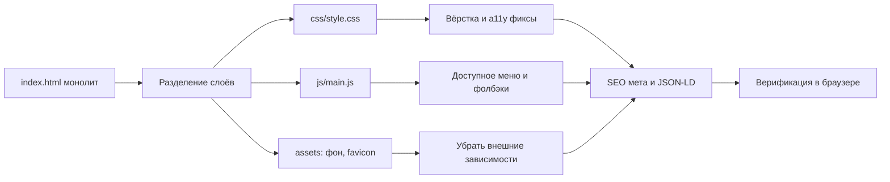

# Архитектурный план оптимизации — лендинг клуба «Мипл»

## Исходное состояние

Проект состоит из единственного файла [`index.html`](../index.html) (~695 строк):
инлайновый CSS (~430 строк), инлайновый JS (~40 строк), вся разметка в одном файле.
Внешних зависимостей нет (шрифт Inter заявлен, но не подключён; фон hero — внешний
плейсхолдер via.placeholder.com).

---

## 1. Перечень технических проблем

### 1.1. Архитектура и структура
| # | Проблема | Место |
|---|----------|-------|
| A1 | Монолит: стили, скрипты и разметка в одном файле — невозможно переиспользовать и кэшировать | весь файл |
| A2 | Инлайновые `style="..."` в разметке (~15 мест) дублируют типографику заголовков секций | [index.html:479-623](../index.html:479) |
| A3 | Дублирование навигации: два одинаковых `<ul class="nav-links">` для десктопа и мобильного меню | [index.html:445-465](../index.html:445) |
| A4 | Хардкод цветов `#111`, `#000` вместо CSS-переменных | [index.html:243](../index.html:243), [index.html:313](../index.html:313), [index.html:360](../index.html:360) |
| A5 | Класс `.grid` объявлен, но конфигурация сетки задана инлайном | [index.html:71](../index.html:71), [index.html:510](../index.html:510) |
| A6 | Переменная `navLinks` в JS не используется (мёртвый код) | [index.html:658](../index.html:658) |

### 1.2. Надёжность и внешние ресурсы
| # | Проблема | Место |
|---|----------|-------|
| R1 | Фон hero — внешний сервис `via.placeholder.com` (сервис нестабилен/недоступен): при сбое секция визуально ломается | [index.html:167](../index.html:167) |
| R2 | Шрифт `Inter` указан в font-family, но нигде не подключается — заявленная типографика не работает | [index.html:29](../index.html:29) |
| R3 | `sections { opacity: 0 }` без JS-фолбэка: при отключённом JS или ошибке в скрипте весь контент невидим | [index.html:60](../index.html:60), [index.html:654](../index.html:654) |
| R4 | `IntersectionObserver` используется без проверки поддержки — на старых браузерах секции останутся невидимыми | [index.html:681](../index.html:681) |
| R5 | Ссылки Telegram через `tg://resolve` не работают на десктопе без установленного клиента | [index.html:642](../index.html:642) |
| R6 | Много «мёртвых» ссылок `href="#"` (каталог, «Купить» ×3, соцсети ×3) | [index.html:561](../index.html:561), [index.html:608-629](../index.html:608), [index.html:646-648](../index.html:646) |

### 1.3. Доступность (a11y)
| # | Проблема | Место |
|---|----------|-------|
| W1 | Бургер — обычный `div`: нет `role="button"`, `tabindex`, `aria-expanded`, `aria-controls`, не управляется с клавиатуры | [index.html:452-456](../index.html:452) |
| W2 | Эмодзи-иконки доступны скринридерам как текст — нет `aria-hidden="true"` | [index.html:444](../index.html:444), [index.html:484-498](../index.html:484), [index.html:646-648](../index.html:646) |
| W3 | Рейтинг звёздами `★★★☆☆` не имеет текстовой альтернативы | [index.html:515](../index.html:515) |
| W4 | Нет skip-link для перехода к основному контенту | [index.html:440](../index.html:440) |
| W5 | Градиентный текст использует только `-webkit-background-clip: text` без стандартного свойства и без фолбэка цвета — в неподдерживающих браузерах текст невидим | [index.html:182-184](../index.html:182), [index.html:264-266](../index.html:264) |
| W6 | Нет `prefers-reduced-motion`: анимации и smooth-scroll не отключаются для чувствительных пользователей | [index.html:27](../index.html:27), [index.html:62](../index.html:62) |

### 1.4. SEO и метаданные
| # | Проблема |
|---|----------|
| S1 | Нет `<meta name="description">` |
| S2 | Нет Open Graph / Twitter Card тегов (превью в соцсетях не работает) |
| S3 | Нет favicon |
| S4 | Нет микроразметки LocalBusiness (JSON-LD) — критично для локального бизнеса |
| S5 | Ссылка на соцсети/Telegram без атрибутов `rel="noopener"` при переходе на внешние ресурсы |

### 1.5. UX и вёрстка
| # | Проблема | Место |
|---|----------|-------|
| U1 | `min-height: 100vh` у hero: на мобильных адресная строка браузера перекрывает часть секции — нужен `100svh`/`dvh` | [index.html:168](../index.html:168) |
| U2 | Фиксированный header перекрывает цель якорных ссылок — нет `scroll-margin-top`/`scroll-padding-top` | [index.html:57](../index.html:57), [index.html:109](../index.html:109) |
| U3 | `overflow-x: hidden` на body маскирует проблему горизонтального скролла вместо её устранения | [index.html:36](../index.html:36) |
| U4 | Мобильное меню не закрывается по Escape/клику вне меню; фон страницы остаётся прокручиваемым | [index.html:660-671](../index.html:660) |
| U5 | Нет визуального отклика при фокусе с клавиатуры (только цвет ссылки) | [index.html:45](../index.html:45) |

---

## 2. Архитектурный план оптимизации

### Целевая структура файлов

```
Лабораторная4/
├── index.html          # семантическая разметка без инлайновых стилей
├── css/
│   └── style.css       # все стили, разбитые секциями-комментариями
├── js/
│   └── main.js         # интерактив (burger, observer), подключение defer
├── assets/
│   ├── hero-bg.webp    # локальный оптимизированный фон hero
│   └── favicon.svg     # favicon с эмблемой 🎲
└── plans/
    └── optimization-plan.md
```



### Этап 1 — Разделение слоёв (A1, A6, R1, R2)
1. Вынести CSS в `css/style.css`, подключить через `<link rel="stylesheet">`.
2. Вынести JS в `js/main.js`, подключить с `defer`.
3. Удалить мёртвую переменную `navLinks`.
4. Заменить внешний плейсхолдер на локальный `assets/hero-bg.webp` (добавить
   `<link rel="preload" as="image">` для LCP).
5. Подключить Inter через Google Fonts с `preconnect` (или оставить системный стек
   и убрать упоминание Inter — решить на этапе реализации).

### Этап 2 — Рефакторинг CSS (A2, A4, A5, W5, W6, U1, U2)
1. Все инлайновые стили заменить классами: `.section-title`, `.section-lead`,
   `.section-note`, `.grid-games`.
2. Хардкодные цвета `#111`, `#000` → переменные `--bg-section-alt`, `--bg-footer`.
3. Градиентному тексту добавить стандартное `background-clip: text` и
   фолбэк `color: var(--accent)` до `@supports`.
4. Добавить `@media (prefers-reduced-motion: reduce)` — отключение анимаций и
   smooth-scroll.
5. `min-height: 100vh` → `min-height: 100svh` (с фолбэком vh).
6. Добавить `scroll-padding-top` на `html` (или `scroll-margin-top` на секциях)
   под высоту фиксированного header.

### Этап 3 — Разметка и доступность (A3, W1–W4, U4)
1. Устранить дублирование навигации: один `<nav>`, мобильное меню показывается
   чистым CSS без копии списка.
2. Бургер → `<button>` c `aria-expanded`, `aria-controls`, `aria-label`;
   обработка `Escape`, клика вне меню, блокировка прокрутки body при открытом меню.
3. Эмодзи-иконки → `aria-hidden="true"`.
4. Рейтинг звёздами: добавить `<span class="sr-only">Рейтинг 3 из 5</span>`.
5. Добавить skip-link «Перейти к содержимому» и `:focus-visible` стили.
6. `sections { opacity: 0 }` → анимация только при поддержке JS (класс `js` на
   `<html>` из скрипта) + фолбэк без IntersectionObserver.

### Этап 4 — SEO (S1–S5, R5, R6)
1. `<meta name="description">`, Open Graph + Twitter Card.
2. Favicon `assets/favicon.svg` + `<link rel="icon">`.
3. JSON-LD `LocalBusiness` (название, адрес, телефон, часы работы, geo).
4. `tg://resolve` → `https://t.me/mipl_spb` с `target="_blank" rel="noopener"`.
5. Мёртвые ссылки: каталог → `#games`, «Купить» → `#` + заглушка/примечание или
   якорь на контакт в футере; соцсети — реальные URL либо `disabled` состояние.

### Этап 5 — Верификация
1. Проверить страницу в браузере: hero, меню, анимации, якорные переходы.
2. Проверить mobile-вид (≤768px), работу бургера с клавиатуры.
3. Проверить рендер при отключённом JS (контент видим).
